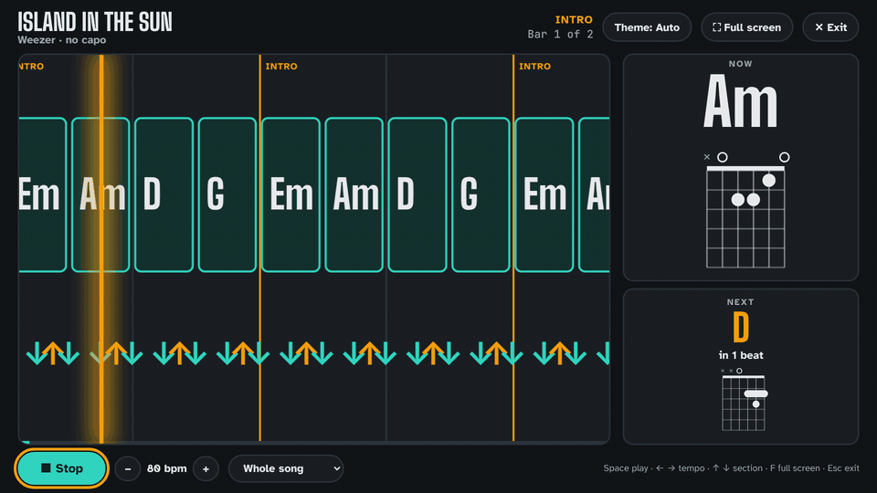
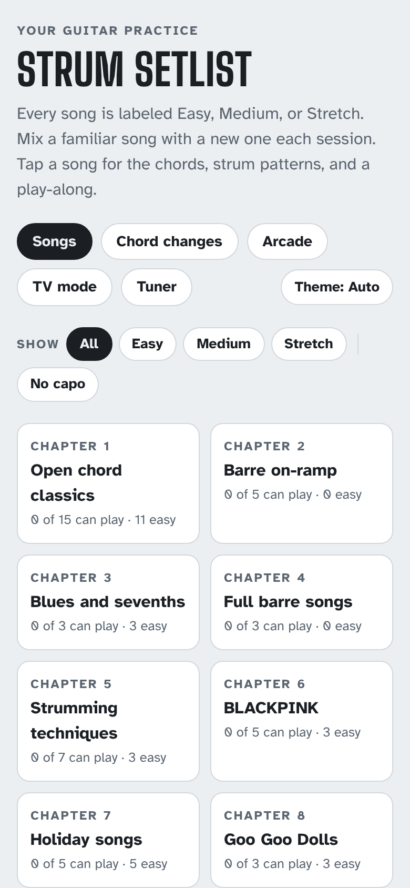
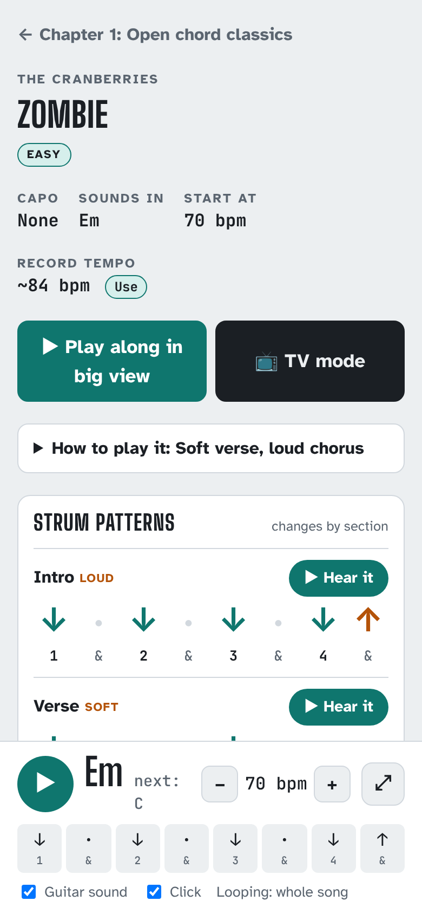
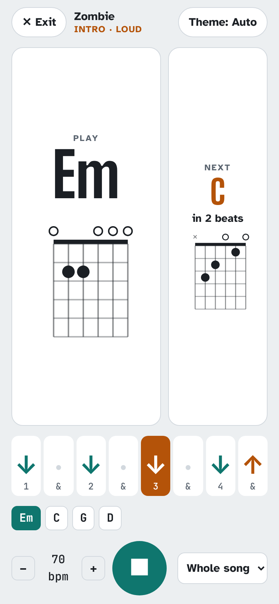
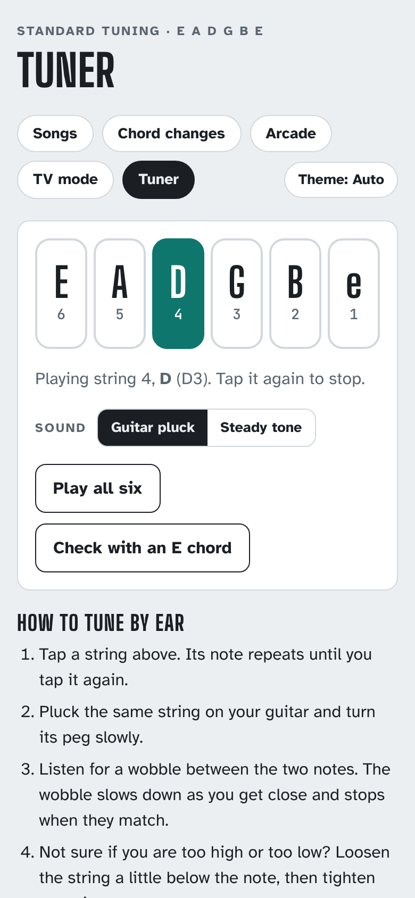

# Strum Setlist

Guitar practice for people who know their open chords and want to keep growing without weekly lessons.
Songs are grouped into chapters and labeled by difficulty, every song has a play-along with real acoustic
guitar sound, and TV mode turns any screen into a scrolling chord highway you can play along with from the couch.



**Try it:** `https://<your-github-username>.github.io/strum-setlist/` (available once GitHub Pages is turned on; see below)

## Features

| | |
|---|---|
|  |  |
|  |  |

- **50 songs in 9 chapters**, from open chord classics through a barre chord on-ramp, blues, strumming
  techniques, BLACKPINK, holiday songs, Goo Goo Dolls, and modern pop.
- **Easy, Medium, and Stretch labels**, plus a **No capo** filter.
- **Play-along with real guitar sound.** Strum patterns change by section (quiet verse, loud chorus), with
  light and full strums, chucks, bass notes, palm muting, swing, and section endings.
- **Easier shapes for barre chords.** Barre songs can switch between a simpler shape and the full barre.
- **Big view for phones** and **TV mode** for big screens, with the current and next chord shapes, a beat
  countdown to the next change, and keyboard or TV remote controls. The screen stays awake while you play.
- **Practice tools:** a hands-free chord change drill, Chord Roulette, Strum It Back (hear a pattern, then
  play it), Name That Chord ear training, and a tuner that plays reference notes.
- **Light and dark themes.** Progress, best scores, and settings are saved in your browser.

## Run it

It is a static website with no build step and no server code.

**On GitHub Pages (recommended):**

1. Push this repository to GitHub.
2. In the repository, go to **Settings > Pages** and set **Source** to **GitHub Actions**.
3. The included workflow checks the song data and publishes the site on every push to `main`.

**On your computer:**

```bash
python3 -m http.server 8000
# then open http://localhost:8000
```

Opening `index.html` directly from your file system also works, but browsers block loading the guitar
samples that way, so you will hear a simpler synthesized guitar sound instead.

## Use it on your TV

Open the **TV mode** tab and pick a song. To get it on the TV:

- **Laptop with Chrome:** use **Cast** from the Chrome menu, or connect with an HDMI cable.
- **iPhone or iPad:** use **Screen Mirroring** to an Apple TV or AirPlay TV, with the phone turned sideways.
- **Android:** use **Cast** or **Smart View** from quick settings.
- **TV web browser:** open the GitHub Pages link directly.

| Key | Action |
|---|---|
| Space or OK | Play and stop |
| Left and Right | Tempo down and up by 5 bpm |
| Up and Down | Loop the previous or next section |
| F | Full screen |
| Esc | Exit TV mode |

## Add or change a song

Songs live in [`data/songs.js`](data/songs.js) and chord shapes in [`data/chords.js`](data/chords.js).
The comment at the top of `songs.js` explains every field. A minimal song looks like this:

```js
{
  "id": "my-song",
  "title": "My Song",
  "artist": "Someone",
  "chapter": 1,
  "level": "easy",
  "key": "G",
  "capo": 0,
  "bpm": [80, null],
  "strum": "D-dU-udU",
  "skill": "What this song teaches",
  "tip": "One or two sentences on how to play it.",
  "sections": [
    {"name": "Verse", "repeat": 2, "vol": 0.8, "bars": [["G"], ["C"], ["D"], ["G"]]},
    {"name": "Chorus", "repeat": 2, "vol": 1.1, "bars": [["C", "D"], ["G"], ["C", "D"], ["G"]]}
  ]
}
```

Then check your changes:

```bash
node scripts/validate-songs.js
```

It reports problems such as a chord with no shape, a strum pattern of the wrong length, or an unknown
level. The same check runs automatically on GitHub for every push and pull request.

## How it works

- Plain HTML, CSS, and JavaScript with no framework or dependencies.
- Sound comes from the browser's Web Audio API: recorded acoustic guitar notes are pitch-shifted to build
  each chord, and each string is started a few milliseconds apart to sound like a real strum. Light
  strums, chucks, palm muting, and swing are all shaped in code.
- Timing uses a look-ahead scheduler on the audio clock, so playback stays steady even when the screen
  is busy redrawing TV mode.
- Chord diagrams are drawn as SVG from a six-character shape such as `x32010`.
- The Screen Wake Lock API keeps the screen on while music is playing.

```
index.html          page structure
css/styles.css      all styles, with light and dark themes
data/chords.js      chord shapes
data/songs.js       chapters and songs
js/                 app code, loaded in order (core, audio, player, views, TV mode, games, tuner)
samples/            acoustic guitar notes (CC BY 3.0)
scripts/            song data check
```

## Credits and license

The code is released under the [MIT License](LICENSE). The guitar samples come from
[nbrosowsky/tonejs-instruments](https://github.com/nbrosowsky/tonejs-instruments) and are licensed
[CC BY 3.0](https://creativecommons.org/licenses/by/3.0/). Chord charts are simplified practice
arrangements, not official transcriptions, and no lyrics or recordings are included. See
[CREDITS.md](CREDITS.md) for full attribution and chart sources.
